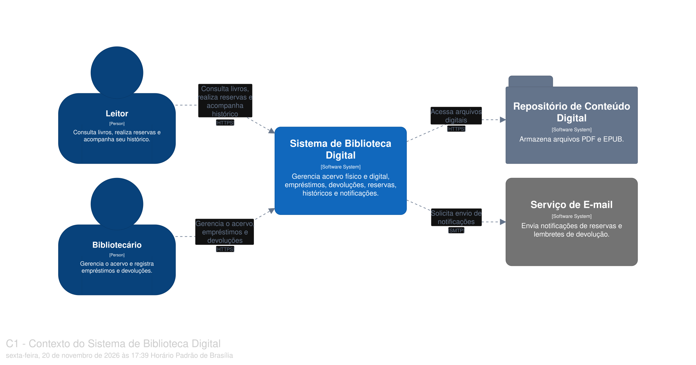
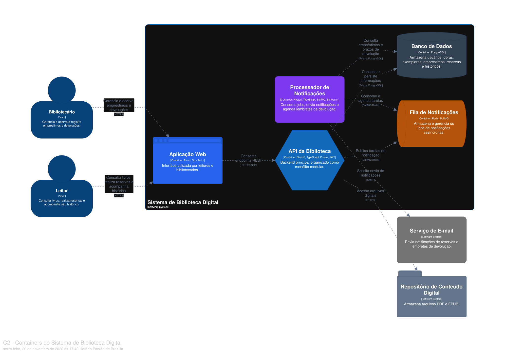
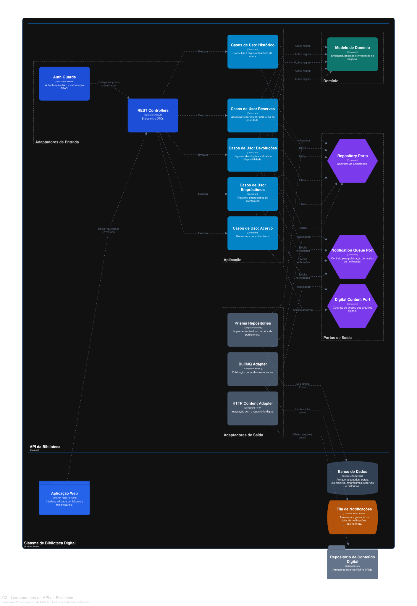
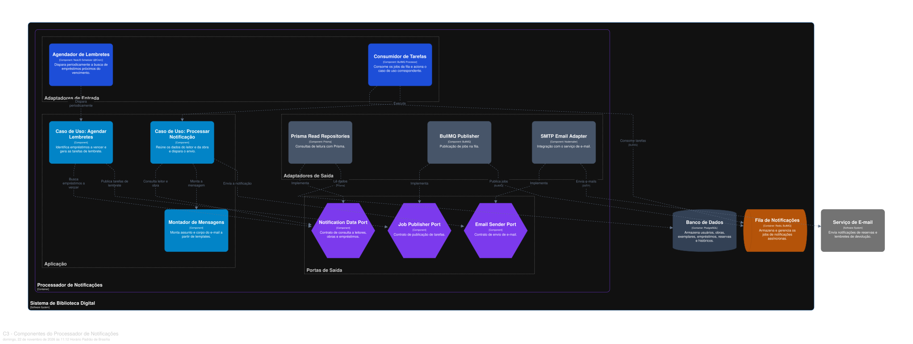

# Documentação Arquitetural

Esta documentação apresenta as visões arquiteturais do **Sistema de Biblioteca Digital**, seguindo o modelo C4.

Os diagramas são desenvolvidos em **Structurizr DSL**, representando a estrutura do sistema, seus componentes e suas interações.

Os modelos, relacionamentos, visões e estilos estão definidos no arquivo [workspace.dsl](structurizr/workspace.dsl).

## C1 — Diagrama de Contexto

Apresenta o Sistema de Biblioteca Digital, seus usuários (Leitor e Bibliotecário) e as integrações com o Serviço de E-mail e o Repositório de Conteúdo Digital.

## C2 — Diagrama de Containers

Detalha os principais containers do sistema: Aplicação Web, API da Biblioteca, Banco de Dados, Processador de Notificações e Fila de Notificações, incluindo suas tecnologias e mecanismos de comunicação.

## C3 — Diagrama de Componentes

### API da Biblioteca

Apresenta os componentes internos da API NestJS, organizados conforme os princípios da Arquitetura Hexagonal e da Clean Architecture, incluindo adaptadores de entrada, casos de uso, domínio, portas e adaptadores de saída.

### Processador de Notificações

Apresenta os componentes do processamento assíncrono de notificações: o agendamento de lembretes de devolução (NestJS Scheduler), o consumo de tarefas da fila (BullMQ), o processamento e a montagem das mensagens, a consulta aos dados no PostgreSQL e a integração com o Serviço de E-mail por SMTP. Segue a mesma organização hexagonal da API, com adaptadores de entrada, casos de uso, portas e adaptadores de saída.

